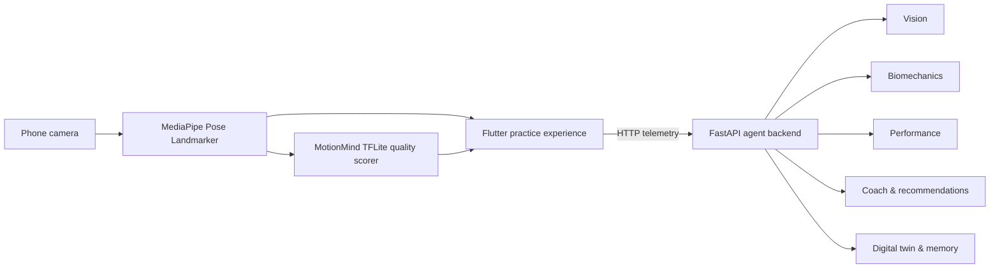

<div align="center">

# MotionMind

### Train with your camera. Understand every movement.

MotionMind is an on-device movement-coaching platform that combines a Flutter
mobile experience, MediaPipe pose tracking, TensorFlow Lite quality scoring,
and a FastAPI biomechanics backend.

<p>
  <a href="https://github.com/anshuman9468/motionmind"><strong>View source</strong></a>
  ·
  <a href="#quick-start">Quick start</a>
  ·
  <a href="#run-on-a-phone">Run on a phone</a>
  ·
  <a href="#backend-api">API reference</a>
</p>

<p>
  
  
  
  
  
  
</p>

</div>

> **Core idea:** keep the latency-sensitive movement loop on the phone, then
> use the backend for richer analysis, coaching, recommendations, and history.

## Why MotionMind?

MotionMind turns a phone camera into a practical movement companion. It detects
human pose locally, scores movement quality, and turns the resulting telemetry
into understandable feedback. The app remains useful when the backend is
temporarily unavailable because the camera and core pose inference run on the
device.

## Product capabilities

| Experience | What it does |
| --- | --- |
| **Live practice** | Camera-based pose tracking with front/rear camera switching. |
| **Movement quality** | MediaPipe landmarks plus a lightweight TFLite quality model. |
| **Biomechanics** | Converts pose data into interpretable movement metrics. |
| **AI coaching** | Generates feedback, corrections, and encouragement. |
| **Skill progression** | Roadmaps, recommendations, performance scores, and session memory. |
| **Digital twin** | Maintains a user profile built from recent practice telemetry. |
| **Cross-platform UI** | Flutter screens for practice, home, marketplace, coaching, and profile. |

## System overview



### Runtime split

- **On device:** camera frames, pose landmarks, quality inference, responsive
  practice UI, and camera controls.
- **Backend:** agent orchestration, biomechanics interpretation, performance
  evaluation, coaching, recommendations, digital-twin updates, and memory.
- **Optional services:** Firebase authentication and Firestore. The app falls
  back to local mock providers when Firebase is not configured.

## Repository map

```text
MotionMind/
├── android/                 # Android host and native inference bridge
├── ios/                     # iOS host and native camera bridge
├── lib/                     # Flutter application
│   ├── core/                # Routing, theme, services, shared widgets
│   └── features/            # Practice, home, coaching, marketplace, etc.
├── backend/                 # Active FastAPI service
│   ├── app/                 # Schemas and active agent routers
│   ├── tests/               # Active backend tests
│   └── legacy/              # Earlier agents, prompts, and ML models
├── frontend/                # Lightweight browser demo
├── test/                    # Flutter tests
├── web/ linux/ macos/       # Additional Flutter targets
├── pubspec.yaml             # Flutter dependencies and scripts
└── README.md
```

## Requirements

- Flutter 3.44.1, with Dart 3.12.1 or a compatible SDK.
- Python 3.10 or newer.
- Android platform tools (`adb`) for a physical Android device.
- A USB cable for the most reliable phone workflow.
- Android Studio is optional; Flutter and the Android SDK command-line tools
  are sufficient for Android development.

Check the toolchain:

```bash
flutter doctor
python3 --version
adb version
```

## Quick start

### 1. Install Flutter dependencies

Run this from the repository root:

```bash
flutter pub get
```

### 2. Start the backend

In a separate terminal:

```bash
cd backend
python3 -m venv .venv
source .venv/bin/activate       # Windows: .venv\Scripts\activate
pip install -r requirements.txt
PYTHONPATH=. uvicorn app.main:app --host 0.0.0.0 --port 8000
```

The service is available at `http://127.0.0.1:8000`.

### 3. Run the Flutter app

From the repository root:

```bash
flutter devices
flutter run
```

Build a debug APK when you need an installable artifact:

```bash
flutter build apk --debug
```

The APK is generated at
`build/app/outputs/flutter-apk/app-debug.apk`. Build output is ignored by Git.

## Run on a phone

### USB workflow — recommended

1. On the phone, enable **Developer options** and **USB debugging**.
2. Connect the phone and accept the RSA authorization prompt.
3. Confirm the device:

   ```bash
   adb devices
   flutter devices
   ```

4. With the backend running, forward port 8000 over USB:

   ```bash
   adb reverse tcp:8000 tcp:8000
   ```

5. Launch the app on the listed device:

   ```bash
   flutter run -d <device-id>
   ```

USB reverse forwarding lets the phone use the default backend URL,
`http://127.0.0.1:8000`, without changing the app.

### Wi-Fi workflow

Keep the phone and computer on the same network. Start Uvicorn with
`--host 0.0.0.0`, then pass the computer’s LAN address to Flutter:

```bash
flutter run \
  --dart-define=MOTIONMIND_API_URL=http://<computer-ip>:8000
```

For Android 11+, use the phone’s **Wireless debugging** pairing flow. For an
already paired device, this classic ADB flow is also available:

```bash
adb tcpip 5555
adb connect <phone-ip>:5555
```

## Backend API

Open interactive Swagger documentation at
[`http://127.0.0.1:8000/docs`](http://127.0.0.1:8000/docs) while the backend is
running.

| Route | Method | Responsibility |
| --- | :---: | --- |
| `/` | `GET` | Health check and active-agent list |
| `/agents/vision` | `POST` | Vision and pose analysis |
| `/agents/biomechanics` | `POST` | Biomechanical metric extraction |
| `/agents/performance` | `POST` | Score and performance evaluation |
| `/agents/coach` | `POST` | Coaching feedback |
| `/agents/recommendation` | `POST` | Training recommendations |
| `/agents/planner` | `POST` | Skill roadmap generation |
| `/agents/twin/{user_id}` | `GET` | Read a digital-twin profile |
| `/agents/twin/update` | `POST` | Update a digital-twin profile |
| `/agents/memory/store` | `POST` | Store session memory |
| `/agents/memory/history/{user_id}` | `GET` | Read user session history |

## On-device inference assets

| Asset | Purpose |
| --- | --- |
| [`pose_landmarker_lite.task`](android/app/src/main/assets/pose_landmarker_lite.task) | MediaPipe body-pose model |
| [`motionmind_quality.tflite`](android/app/src/main/assets/motionmind_quality.tflite) | Lightweight movement-quality scorer |

The Android native bridge handles camera frame conversion, pose inference, and
the TFLite output tensor. Backend failures do not disable the local camera loop.

## Verification

Run the active backend tests:

```bash
PYTHONPATH=backend pytest -q backend/tests
```

Run the preserved ML/agent pipeline tests:

```bash
pytest -q backend/legacy/tests
```

Run Flutter checks when the SDK is installed:

```bash
flutter analyze
flutter test
```

## Troubleshooting

<details>
<summary><strong><code>adb devices</code> is empty</strong></summary>

- Unlock the phone and confirm USB debugging is enabled.
- Reconnect the cable and select **File transfer** if prompted.
- Accept the RSA authorization dialog on the phone.
- Restart ADB with `adb kill-server && adb start-server`.

</details>

<details>
<summary><strong>The phone cannot reach the backend over USB</strong></summary>

Confirm Uvicorn is running, then recreate the port reverse:

```bash
adb reverse --remove tcp:8000
adb reverse tcp:8000 tcp:8000
```

</details>

<details>
<summary><strong>The phone cannot reach the backend over Wi-Fi</strong></summary>

Use the computer’s LAN IP instead of `127.0.0.1`, start Uvicorn with
`--host 0.0.0.0`, and allow port 8000 through the firewall:

```bash
flutter run --dart-define=MOTIONMIND_API_URL=http://<computer-ip>:8000
```

</details>

<details>
<summary><strong>Firebase is not configured</strong></summary>

The app falls back to local mock authentication and data providers. Add
platform-specific Firebase configuration only when production authentication
or Firestore is required. Never commit credentials or generated secrets.

</details>

## Storage hygiene

Generated Flutter output, Python virtual environments, test caches, APKs, and
other temporary files are ignored. To reclaim Flutter build space:

```bash
flutter clean
```

Keep Python packages inside `backend/.venv` and do not commit `.env` files,
API keys, Firebase credentials, model caches, or build artifacts.

## Contributing

1. Keep changes inside the unified root layout.
2. Add or update tests for backend behavior.
3. Run the relevant Python and Flutter checks.
4. Keep secrets and generated files out of commits.
5. Open a focused pull request with a clear description of the user-facing
   change.

<div align="center">

<sub>Built for curious bodies, better feedback, and measurable progress.</sub>

</div>
